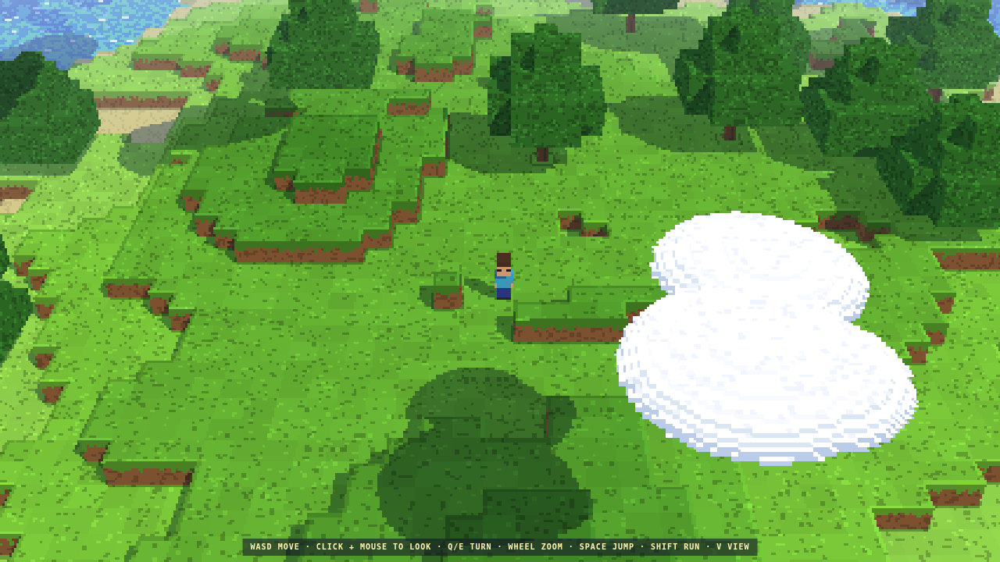

# Mode7craft v10

Defaults (for users with no saved settings): **Grafik HQ, Tid Cykel, Kanter Skarpa, Dither Av, Löv Auto** (Löv+splats in HQ, Löv in Standard). Saved settings (localStorage `m7c-fx`, `m7c-tod`, `m7c-edge`, `m7c-dither`) win over the defaults, and URL params win over both. `?fx=0&edge=0&leaf=0` gives the classic Standard look: pixel-identical to v9 and to v8 except for the sun glitter on water.

A tiny Minecraft-style island rendered SNES Mode 7 / sprite-stacking style: no meshes, no polygons.

- `core/`: Rust `no_std` -> wasm32 (no wasm-bindgen). It handles world gen (a 128x128x16 voxel island with birch trees), player physics/collision, and the mutable world: `pick` (DDA raycast), `break_block`, `place_block` (refuses cells that overlap the player; z=0 is bedrock) and incremental heightmap updates.
- Block editing: only the touched voxel and heightmap texel are re-uploaded to the GPU. Hotbar: grass, dirt, stone, sand, birch log, leaves, planks, torch. Edits persist in localStorage (`m7c-edits-1`); `?reset` clears them.
- Birch logs are analytic ray-cylinder hits (they cast round shadows too) with procedural bark: off-white, dark dashes and sparse knots.
- `web/scene.wgsl`: one full-screen fragment shader, no meshes. Terrain and trees use an exact voxel DDA (Amanatides-Woo) over the block grid. The sprite-stacked avatar uses a texel DDA in its own bounding box. Clouds are stacked 2D slices. The whole cloud cluster that hides the avatar, or that it stands under, is drawn at ~50% with a screen-stable 4x4 Bayer dither; clouds near the camera step down in dither levels. Views: chase, first person (with a pixel crosshair drawn in the blit pass) and top-down. V, Y or VIEW cycles them. 8x8 procedural pixel textures, shadows, water/foam and fog.
- Edges (v8, settings row `Kanter`, saved as `m7c-edge`, `?edge=0|1|2`). `Pixel` is the classic look, pixel-identical to v7. The default has been `Skarpa` since v9.1.
  - `Mjuka` (cheap): edge-aware upscale in `blit.wgsl`. The scene writes a surface id into alpha (coplanar faces share one), and the blit applies a Scale2x-style corner rule with an anti-aliased 45-degree cut only where real geometry meets. Staircases on silhouettes, block steps and the shore become smooth diagonals; texture texels, dithering and water bands stay pixel-sharp. It costs 5 texel loads per screen pixel and nothing extra in the scene. Works in Standard and HQ.
  - `Skarpa` (native-res): rays are traced at up to native resolution. The budget is 1.0M internal pixels in Standard and 0.5M in HQ, DPR-aware, with a fractional scale. Because all shading already reads the 8x8 texel grid (textures, shadow probes, water texels, cloud cells), surfaces keep their big SNES texels while silhouettes, the shoreline, water-band edges and the avatar become crisp at screen resolution. Cloud dither, the target outline and the crosshair are scaled back to the classic pixel size (`U[9].w` / blit `B.z`). Dynamic resolution (v9.1): Skarpa starts at 40% of its cap (200k internal pixels in HQ, 400k in Standard). After a 2 s warm-up it checks the real frame time every second. Under about 20 fps it drops at once to ×0.6. Under about 45 fps for 2 s it drops to ×0.75, and that level then becomes a ceiling. It never drops below 25k pixels in HQ or 45k in Standard. Above about 55 fps for 3 s it climbs ×1.25, up to the mode cap or the last level that was too slow. Weak phones settle near the classic resolution, and strong ones climb to native. `?area=` fixes the starting budget and turns off climbing.
- Dithering (v9, settings row `Dither: Auto / På / Av`, saved as `m7c-dither`, `?dither=auto|1|0`). It is an ordered 4x4 Bayer dither in `blit.wgsl`: each channel is quantised to 16 levels per channel, and only the band transitions (±0.25 of a step) are dithered between the two neighbouring tones. Smooth gradients (sky, haze, golden-hour falloff, soft-shadow edges, HQ lighting) become SNES-style dithered bands. The Bayer cell follows the art-pixel grid, so it stays chunky in every edge mode (Pixel/Mjuka/Skarpa). It costs a few ALU ops per screen pixel and nothing in the scene. `Auto` = on in HQ, off in Standard. The default has been `Av` (off) since v9.1.
- Sun path on water (v9): the water surface is cut into per-texel facets with a frame-stepped hash. A facet flashes when its jittered half-vector lines up with the sun, so you get a glittering path of white-gold sparkles under the sun. It stretches out naturally at low sun (Kväll gives a long golden path) and follows the time of day in HQ, where it is HDR-lit and blooms. Standard uses the fixed sun. Shadowed water gets no glitter. HQ already had grazing-angle sky reflection (Fresnel), which is unchanged.
- Baked sun shadows (v9, HQ): a compute pass (`bake` in `scene.wgsl`, run by `main.js`) classifies every air cell that touches a solid block (and the water surface layer) as fully lit, fully shadowed or mixed. It fires 6 rays around the shadow cone from 9 points per cell and stores 1 byte per cell (`SC`, 256 KB storage buffer). It reruns only when the sun direction moves more than about 0.4° (Cykel) or the world is edited or loaded. The bake samples just inside and outside the cone rim to cover that drift. Per pixel, the HQ soft-shadow cone (and the light-shaft samples) skips the world trace in lit or dark cells. Mixed cells (shadow edges, rays through leaves or near round logs) still trace exactly as before, and the avatar's own shadow is still traced. The result matches v8 to within a handful of low-res pixels.
- Leaves (v10, settings row `Löv: Block / Löv / Löv+splats`, saved as `m7c-leaf`, `?leaf=0|1|2`; the default `auto` gives 2 in HQ and 1 in Standard):
  - `Löv` (porous leaves, Standard and HQ, all edge modes): every face a ray crosses into, out of or between leaf voxels is an alpha-tested 8x8 pixel-art leaf sprite (64-bit mask, about 1/3 holes). It is flipped or rotated per face, and on outer faces half the edge texels drop out for a ragged crown rim. Rays pass through the holes into the inner layers, so crowns read as leaves with depth. Colour comes from the sprite: light where a leaf has a gap above, dark with a gap below, speckled mid greens. Shadow rays use the same test: in Standard the sun probe passes through holes, and in HQ each solid leaf texel crossed lets 15% through. Light dapples through the crowns, and the v9 shadow cache treats leafy cells as mixed, so they are traced per pixel. The mode is a pipeline constant (`LEAF`), so `Block` compiles the old solid path unchanged. With `Löv` on, the main DDA still stops at the first leaf cell. A separate short walk (`leafWalk`, and the same in `hqTrans`) then tests the sprite faces and resumes the DDA behind the leaves, so the hot loop stays as small as before. Inner faces and the far side of a crown are hit too, which gives layered depth.
  - `Löv+splats` (HQ only): small gaussian leaf splats on the crown surface, about 8 per exposed leaf voxel (sides and top), generated in the vertex shader from a list of exposed leaf voxels that JS rebuilds after edits (`index | open-face mask << 18`, up to 6000 voxels). No assets. Each splat is a randomly rolled ellipse, at least about one art pixel in size, that sways in a gentle gust-modulated wind. It is lit once per splat: sun through the baked shadow cache (or one transmittance ray), translucency, sky and torches, with sun light snapped to 4 levels (palette-like), a 4-green palette and fog. Splats draw in the HQ scene pass with a depth test against the scene (the HQ scene fragment shader writes `frag_depth`). Alpha is a hard ellipse with a thin art-pixel Bayer-dithered rim, so the result is order-independent with no sorting. Far splats are thinned (down to about 2 per voxel), splats closer than 1.2 blocks are culled, the total is capped (`?splats=`, default 24000), and the count per voxel scales down with dynamic resolution. The vertex shader reads a copy of the shadow cache, which is copied after each bake.
- Layered water (v7, Standard and HQ), after asynkimo's "Basic water tile vs Layered water":
  - Stepped depth bands, from semi-transparent shallow teal over the sand to opaque deep blue-teal. Depth comes from the sea-floor height, smoothed over block columns and jittered per 2x2 texels, so band edges are pixel-art steps that follow the slope.
  - The sea floor slopes at about half the land slope (generator change below sea level only), so there are wide shallow shelves.
  - Through the shallow bands a short refracted ray (12 DDA steps) shows the sea floor, the submerged bases of blocks and trunks, and the avatar's legs, all tinted teal. Open deep sea skips that ray.
  - A 1-texel light-blue/white shoreline where the surface touches anything solid: the coast, placed blocks, round logs. It pulses slowly, with a dotted second ring.
  - Shadows from trees, objects and clouds darken the water and suppress sparkles.
  - Sparkles are fixed spots that twinkle in frame steps, mostly over shallow lit water.
  - Wading: the shallow shelf (floor 0.75 below the surface) is walkable, with a foam ring and a slow ripple around the avatar. Deeper sea is still a wall.
  - In HQ the layered colour is lit by sun and sky. Reflections are weak over the shallows and strongest over deep water at grazing angles, and the sun glint is kept. Foam and sparkles are lit diffusely without reflection.
  - Everything outside water is unchanged from v6 in Standard: verified with `tools/maskdiff.py` against a water-mask build.
- Torches (hotbar slot 8): pixel-art stick with a flickering flame, no collision (you can walk through them and place them where you stand). The nearest 32 torches (re-sorted every 0.3 s) go into a 512-byte uniform list; each is a warm point light with range 8 and per-torch flicker. Standard adds a subtle unoccluded warm glow. HQ uses an emissive flame (it blooms) and a shadow ray per torch, so walls block the light.
- Sunlight through tree crowns (HQ only): sun shadow rays pass through leaves with a per-voxel transmittance (some voxels let 80% of the light through, the rest 12%), which gives dappled light on the ground. Backlit leaves glow when you look toward the sun, and the light shafts trace the canopy near the ground.
- World save/share (settings panel, row `Värld`):
  - `Exportera värld` downloads `mode7craft.m7c`.
  - `Importera värld` opens a file picker. The file is validated, and you are asked to confirm before it replaces a world that has edits.
  - `Dela länk` creates `...#w=<base64url>`. On phones it uses the share sheet; on desktop it copies the link to the clipboard. Links over 30k chars are refused; use the file instead.
  - Opening a `#w=` link loads the world, removes the hash and saves the world to localStorage.
  - File format v1: `M7C` + version byte (1) + flags byte (1 = deflate-raw), then the deflate-raw (CompressionStream) payload, which is 3 bytes per edit: `(index delta << 4) | block id`, big-endian, with indices sorted. A typical house with torches (~80 edits) is about 90 bytes.
- `web/blit.wgsl`: nearest-neighbour integer/fractional upscale of the low-res target, plus the Mjuka edge rule and the Bayer dither.
- Settings (gear button top-right, `G`, or Xbox Start/Menu): `Grafik: Standard / HQ` and `Tid (HQ): Dag / Kväll / Cykel`, saved in localStorage (`m7c-fx`, `m7c-tod`). Since v9.1 the defaults are HQ and Cykel; `Standard` renders the classic look. In the open panel (rows Grafik, Tid, Kanter, Dither, Löv, Värld), arrow keys / D-pad pick a row and change the value. On the `Värld` row, Enter / A runs the selected action. Esc / G / B / Start close the panel.
- HQ ("AAA shaders"): the same `scene.wgsl` built a second time with the pipeline-overridable constant `HQ=true`, so the standard pipeline compiles none of the HQ code. HQ lighting:
  - per-voxel AO
  - soft sun shadows (3-ray cone, sharp at contact), with translucent cloud shadows
  - sky light plus one coloured bounce from the ground block
  - water with reflection ray, Fresnel, refraction tint and sun glint
  - dithered light shafts/haze through cloud shadows
  - sun disc
  - rgba16float HDR target, quarter-res bloom (`web/hq.wgsl`), hue-preserving ACES tonemap
  - day / golden hour / 4-min day-night cycle
  HQ textures are allocated only while HQ is on, and its dynamic resolution starts lower (70k vs 115k internal pixels).
- `web/main.js`: WebGPU setup plus input (touch, gamepad, keyboard/mouse).

    node tools/build.ts                  # build -> dist/ (+ .gz/.br)
    node tools/serve.ts                  # http://localhost:8787
    node tools/shot.ts URL out.png W H   # headless Chrome (SwiftShader WebGPU) screenshot
    node tools/map.ts [seed]             # ASCII map of the generated island
    node tools/test-edit.ts              # Node tests for pick/break/place/collision
    FREEZE=1 NOUI=1 node tools/shot.ts ...  # frozen clock + hidden DOM overlays: deterministic, diffable frames
    python3 tools/diff.py a.png b.png    # pixel diff (used to prove Standard == v4)
    m7.bench(n, forceBake)               # (devtools) ms/frame over n frames; forceBake=true rebakes shadows every frame
    m7.splats, m7.leaves, m7.area        # (devtools) splats drawn, exposed leaf voxels, current pixel budget
    python3 tools/maskdiff.py old.png new.png mask.png  # changed pixels outside water (Standard v6 vs v7 check)

URL params (debug): `?fx=0|1` graphics Standard/HQ, `?edge=0|1|2` edges Pixel/Mjuka/Skarpa, `?dither=auto|1|0` dithering, `?leaf=0|1|2` leaves Block/Löv/Löv+splats, `?splats=` splat cap, `?tod=day|eve|cyc|<hours>` HQ sun, `?area=` internal pixel budget, `?v=0|1|2` chase / first person / top-down, `?z=1.5` zoom, `?r=3.14` camera yaw offset, `?pt=0.4` pitch, `?p=75,65` teleport, `?t=40` cloud time offset.
wasm-opt is looked up on PATH, then in node_modules/.bin.

Controls:
- Settings: gear button (tap/click), `G`, or Xbox Start/Menu.
- Desktop: WASD move, Space jump, Shift run, V view. In first person, click to lock the pointer; LMB breaks, RMB places, and 1-8 or the wheel picks a block. In chase/top-down, click breaks at the pointer, right-click places, drag looks and the wheel zooms. X/C break/place at the block ahead.
- Xbox: left stick move, right stick look, A jump, B/L3 run, Y view, RT break, LT place, LB/RB zoom, D-pad left/right block. In the settings panel: D-pad navigates and A runs a world action (the file picker needs a tap or click, so browsers block it from the gamepad).
- Touch: left side is the joystick, right side drag-look. Tap acts in BREAK/PLACE mode (toggle button); long-press places. In first person the ● button acts at the crosshair. Tap hotbar slots to pick a block.
